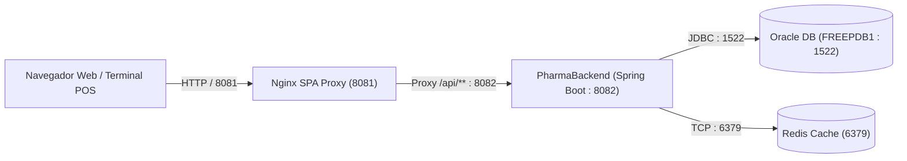

# PharmaBackend — API REST de PharmaSoft

Sistema backend para la gestión de farmacia, ventas, catálogo de productos y clientes desarrollado con Spring Boot 4, Java 25, Spring Data JPA, Oracle Database, Redis Cache y Spring Security.

Actividad autónoma S14: [índice de evidencias](docs/README.md), [informe único](docs/Tequen_LP2_S14_Autonoma.pdf) y [video de respaldo](docs/evidencias/s14-estabilizacion/demostracion-respaldo.webm). Versiones de entrega: `v1.0-demo` en ambos repositorios. Los registros personales pendientes están señalados en el índice.

---

## 🚀 Despliegue en producción

### 1. Arquitectura de Despliegue y Puertos



| Componente | Rol en Producción | Puerto Interno / Externo |
| :--- | :--- | :--- |
| **Nginx** | Servidor de estáticos SPA + Proxy reverso | `8081` |
| **PharmaBackend** | API REST Spring Boot (perfil `prod`) | `8082` |
| **Oracle Database** | Base de datos relacional transaccional | `1522` |
| **Redis** | Caché distribuida en memoria (categorías, productos) | `6379` |

---

### 2. Variables de Entorno de Producción

En el entorno de producción (`SPRING_PROFILES_ACTIVE=prod`), la configuración se parametriza mediante variables de entorno en el sistema o contenedor Docker:

| Variable | Propósito | Ejemplo / Formato |
| :--- | :--- | :--- |
| `SERVER_PORT` | Puerto HTTP donde corre el proceso Spring Boot | `8082` |
| `DB_URL` | Cadena JDBC de conexión a la base de datos Oracle | `jdbc:oracle:thin:@//db-server:1522/FREEPDB1` |
| `DB_USERNAME` | Usuario de esquema de base de datos | `pharmaDB` |
| `DB_PASSWORD` | Contraseña cifrada o secreta de la BD | *(secreto)* |
| `JWT_SECRET` | Clave secreta simétrica HMAC-SHA256 (mín. 256 bits) | *(secreto en Base64)* |
| `JWT_EXPIRACION_MINUTOS`| Tiempo de validez del token de sesión | `60` |
| `REDIS_HOST` | Host o nombre del contenedor/instancia Redis | `localhost` / `redis` |
| `REDIS_PORT` | Puerto de conexión al servicio de Redis | `6379` |

---

### 3. Procedimiento de Construcción, Despliegue y Rollback

#### A. Construcción y Empaquetado
```bash
# Limpiar y empaquetar el JAR ejecutable optimizado
./mvnw clean package -DskipTests
```

#### B. Despliegue con Docker Compose
```bash
# Levantar servicios en segundo plano con perfil de producción
docker compose -f docker-compose.prod.yml up -d --build

# Verificar estado de los contenedores
docker compose ps
```

#### C. Procedimiento de Rollback (Reversión ante fallos)
1. Detener los contenedores activos:
   ```bash
   docker compose down
   ```
2. Revertir la imagen o etiqueta al commit previo estable:
   ```bash
   git checkout HEAD~1
   docker compose -f docker-compose.prod.yml up -d --build
   ```
3. Verificar la salud de la API tras el reinicio:
   ```bash
   curl -I http://localhost:8082/actuator/health
   ```

---

### 4. Matriz de Buenas Prácticas de Producción

| Buena Práctica | Estado | Detalle y Acción Pendiente |
| :--- | :---: | :--- |
| **Separación de perfiles (dev / prod)** | **Cumple** | `application-dev.yaml` y `application-prod.yaml` claramente diferenciados. |
| **Externalización de secretos** | **Cumple** | Base de datos y `JWT_SECRET` se inyectan como variables de entorno sin credenciales en duro. |
| **Validación de esquema JPA** | **Cumple** | En producción se utiliza `hibernate.ddl-auto: validate` para evitar modificaciones de esquema no autorizadas. |
| **Caché con invalidación selectiva** | **Cumple** | Implementado con Spring Cache y Redis en Categorías y Productos con desalojo automático ante escrituras. |
| **Trazabilidad de peticiones** | **Cumple** | `RequestIdFilter` inyecta `requestId` en MDC de logs y en cabecera `X-Request-Id`. |
| **Identificador en errores (Auditoría)** | **Cumple** | `GlobalExceptionHandler` adjunta `requestId` en todas las respuestas `ErrorResponseDTO`. |
| **Logs sin datos sensibles** | **Cumple** | Logs configurados sin imprimir tokens JWT, contraseñas ni números de tarjeta. |
| **Monitoreo con Actuator protegido** | **Cumple** | `/actuator/health` público mínimo y `/actuator/metrics` protegido por roles autorizados. |
| **Terminación SSL / HTTPS** | **Cumple parcialmente** | Requiere configurar certificado TLS/SSL en el proxy reverso Nginx. |

---

### 5. Recomendaciones Priorizadas para los Tres Locales de la Botica

1. **Instancia Centralizada de Redis y Replicación:**
   * Desplegar un clúster o nodo central de Redis para sincronizar el stock e invalidaciones de catálogo en tiempo real entre las tres sucursales físicas, evitando vender productos agotados.
2. **Cifrado en Tránsito con HTTPS y Certificados TLS:**
   * Terminar SSL en el proxy Nginx en cada local o servidor central utilizando certificados emitidos con Let's Encrypt para proteger las credenciales y los tokens JWT en tránsito.
3. **Alertas Automatizadas sobre `/actuator/health`:**
   * Configurar un agente de monitorización (Prometheus + Grafana o Uptime Kuma) que consulte periódicamente `/actuator/health` y alerte por correo o Telegram si Redis u Oracle caen (`status: DOWN`).
